# DashForge

**A free, open-source dashboard for Home Assistant that you build your way.**

DashForge adds a beautiful, touch-friendly dashboard to your Home Assistant sidebar. A step-by-step setup wizard asks you about your rooms, devices, layout and look, so nothing is decided for you, and every choice can be changed afterwards. There are no paid tiers, no device limits, no license keys and no cloud.

[](https://my.home-assistant.io/redirect/hacs_repository/?owner=TechTimCA&repository=DashForge&category=integration)

## Screenshots

Real screenshots of DashForge running in Home Assistant 2026.2. The devices come from Home Assistant's built-in demo.

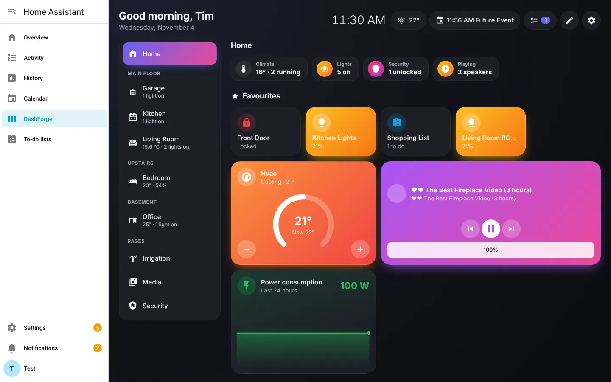

| Vivid: a room | Apple Home style |
| --- | --- |
| 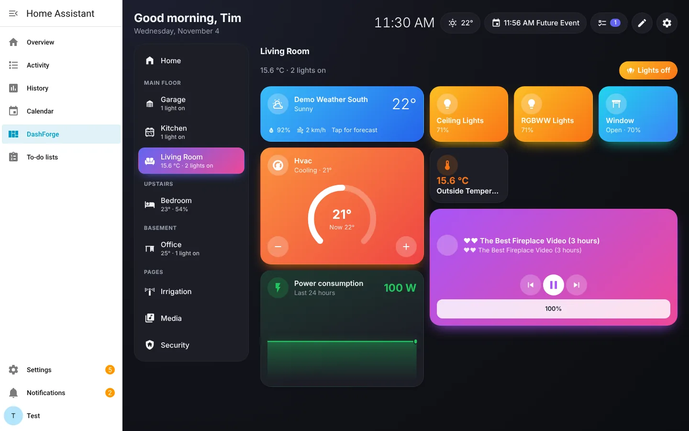 | 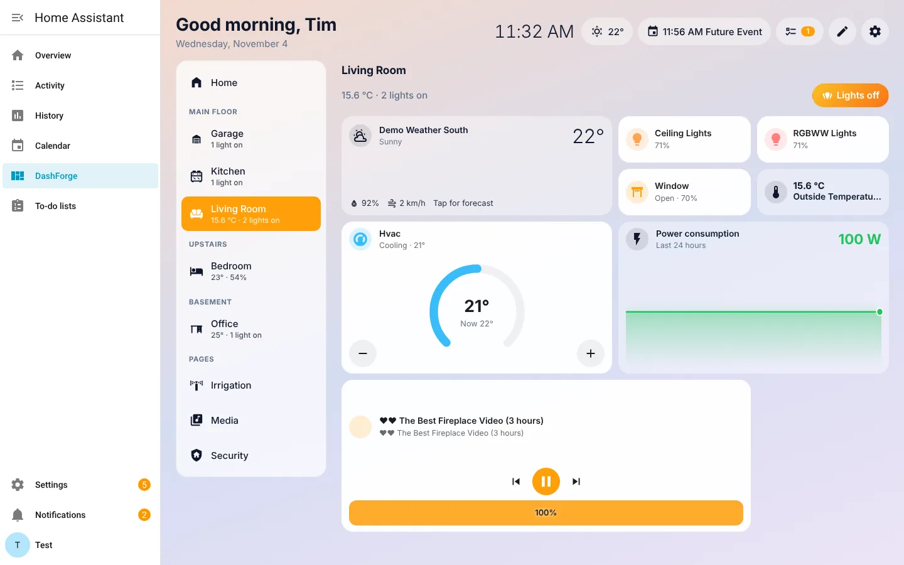 |
| **Homey style** | **Minimal** |
| 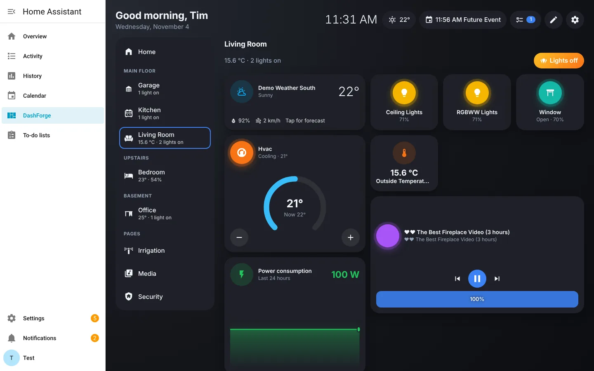 | 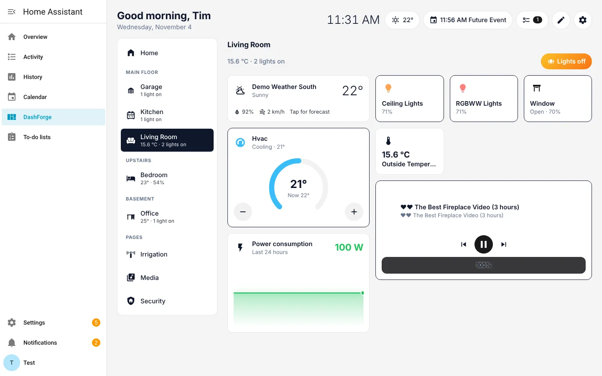 |
| **Irrigation** | **Light controls** |
| 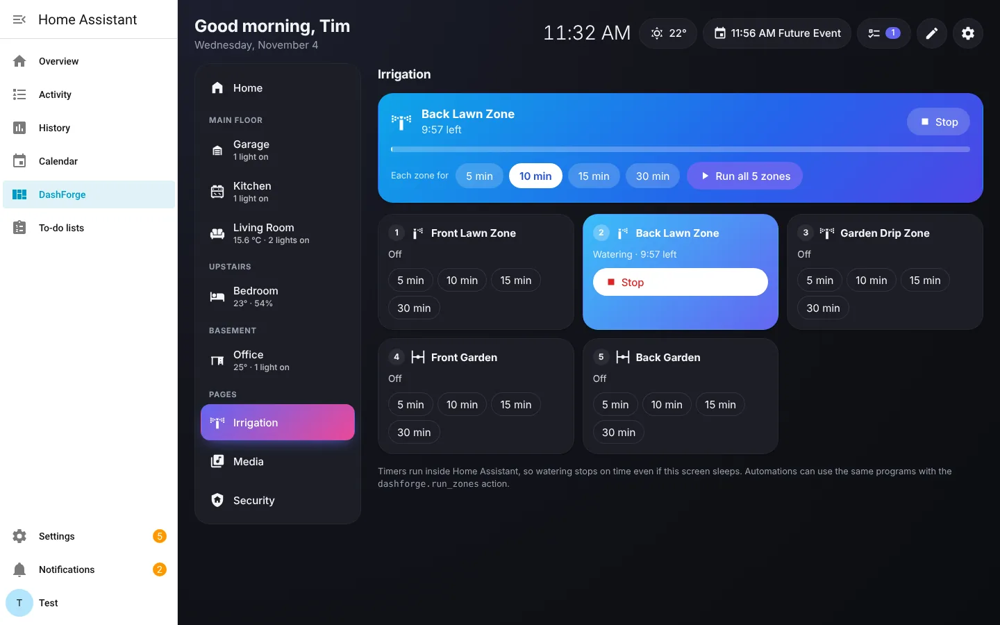 | 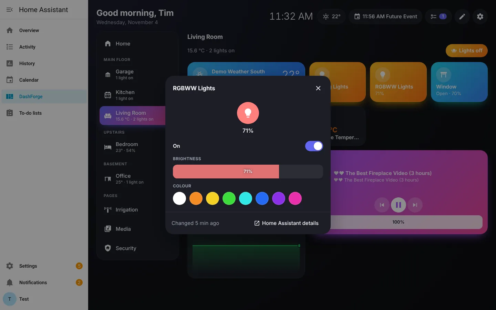 |
| **Edit mode** | **Pick a style** |
| 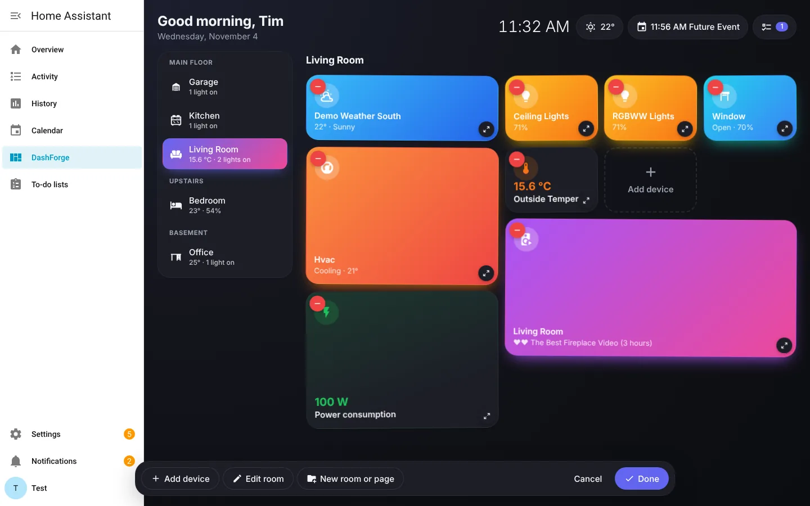 | 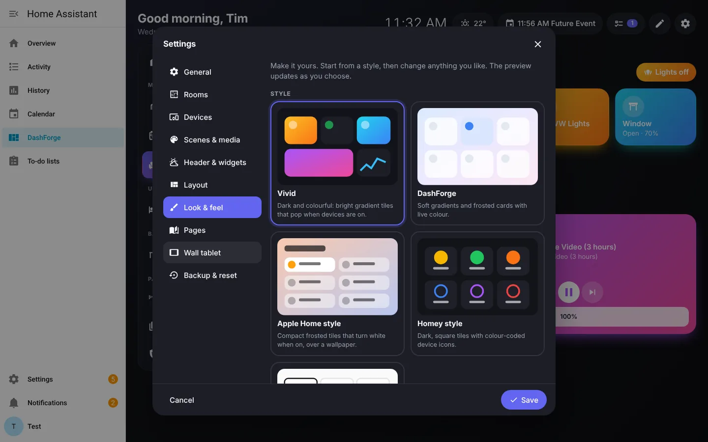 |

One dashboard adapts to every screen, with nothing extra to build:

| Tablet | Phone | Phone: a room |
| --- | --- | --- |
| 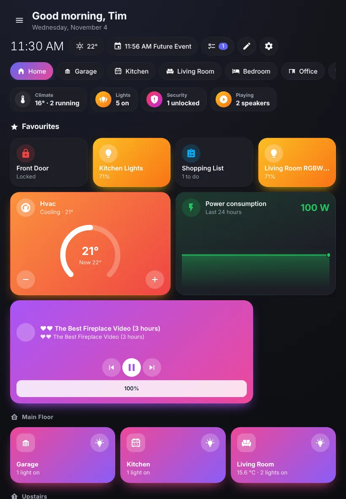 | 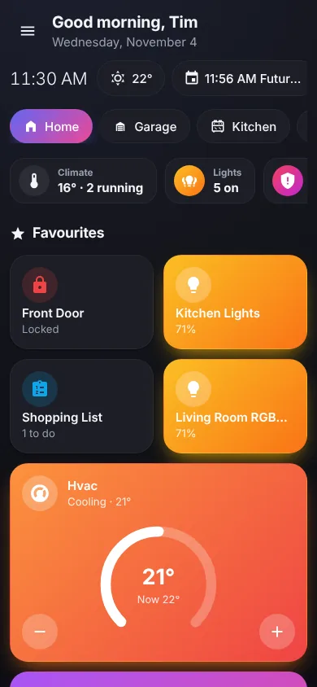 | 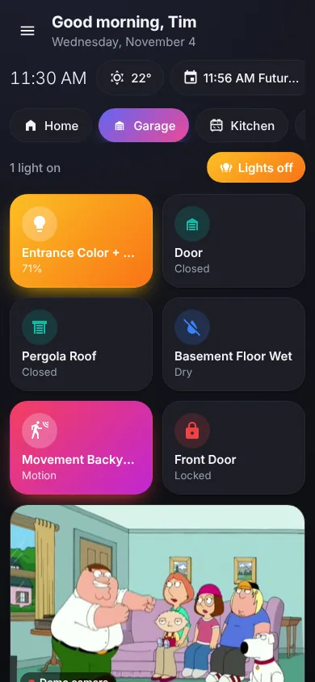 |

## Features

Everything is included, for everyone, with no limits on rooms or devices.

**Set up in one tap**
- **Quick start**: open DashForge and it shows the rooms and devices it found. Pick a look, tap **Create my dashboard**, done. No YAML, no cards to build.
- Rooms come from your Home Assistant areas and floors. Devices that aren't in an area are placed by their names ("Kitchen Pendant" goes in Kitchen), and if your home has no areas at all, DashForge works out rooms from device names.
- Prefer to choose everything? The step-by-step wizard walks through rooms, devices, scenes, widgets, layout, look, pages and wall-tablet settings, and you can run it again any time from Settings.

**Looks like you want it to: mix and match every part**
- Start from a ready-made style (**Vivid**, **Daylight**, **Blocks**, **Console**, **Apple Home style**, **Homey style**, **DashForge**, **Minimal**), then change any part of it on its own.
- **Background**: 19 built-in backgrounds, or **upload your own photos** straight from the dashboard (they are resized and kept in your Home Assistant), or use any picture address. Panels and text adjust to suit the background.
- **Card shape**: tiles, rows, blocks, dials, pills or squares.
- **How cards look when on**: bright gradient, flat colour, glow, soft wash, turns white, light tint, colour ring or outline.
- **Navigation**: tabs on top, a side list, or an app-style bottom dock.
- **Icons**: DashForge's own outline icons, or Home Assistant's.
- **Typeface**: Sora, Manrope, Lexend, Nunito or DM Sans (built in, work offline), or your device's font. **Titles**: regular, big, extra bold or light.
- Light, dark or match Home Assistant; any accent colour; frosted or solid cards; corner roundness; spacing.
- Hide or show the Home Assistant menu with one button; each device remembers its choice.
- Per card: colour, icon, name, size, what a tap does, and whether it shows on Home. Per room: icon, floor and wallpaper.

**One dashboard for every screen**
- The **Auto** layout gives phones and tablets tabs and big screens a side list. Cards reflow to the space available, and pop-ups become bottom sheets on phones.
- Or pick Grid, Sidebar, List or Focus (one room at a time, swipe between rooms). Every layout still adapts to the screen.

**Home screen**
- Status chips at a glance: climate, lights on (tap to turn them all off), security (unlocked doors, open windows), what's playing, and watering.
- Your favourite cards, and every room as a tile grouped by floor, with a one-tap lights button and live status.

**Rooms and floors**
- Rooms follow your Home Assistant floors and areas, or set the floor per room.
- Each room shows its temperature, humidity and lights, with an all-lights on/off button.

**Edit mode**
- Drag cards to reorder, tap − to hide, tap ↔ to cycle the size, tap a card to change its name, icon, colour, tap action or room.
- Add any device to any room or page, create rooms and custom pages, reorder them.
- Nothing is ever deleted from Home Assistant.

**Cards for nearly everything in Home Assistant**
- Lights (brightness, colour temperature, colour, effects), switches, groups, fans (speed, oscillation, presets).
- Climate ring with − / + (single target or heat/cool range), modes, presets and fan modes. Water heaters and humidifiers.
- Blinds, curtains, garage doors and gates (open/stop/close, position, tilt), and valves.
- Cameras with snapshots or **live video**. Locks (unlocking asks first) and alarm panels with code entry.
- Media players with artwork, controls, volume and sources: Spotify, Sonos, Cast and anything else Home Assistant supports.
- Sensors with **live 24-hour graphs**, binary sensors with friendly words (Open, Motion, Wet…).
- Vacuums, lawn mowers, remotes, counters, timers, text inputs, numbers, selects, updates, images, people and device trackers.
- Weather, calendar and to-do list cards that open their forecast, month view or list.
- Scenes, scripts and buttons. Four card sizes. Tap to use, press and hold for details.

**Irrigation**
- An Irrigation page with your zones (switches or valves): run one zone with a tap (5, 10, 15, 30 minutes or your own), run every zone in turn, skip or stop.
- The timers run inside Home Assistant, not in the browser, so watering always stops on time even if the tablet sleeps. Zones turn off when Home Assistant shuts down.
- Automations can run the same programs with the `dashforge.run_zones`, `dashforge.skip_zone` and `dashforge.stop_irrigation` actions.

**Header and widgets**
- Greeting, date and clock (12 or 24 hours).
- Weather from any Home Assistant weather entity, with hourly and 7-day forecasts. Optional Open-Meteo fallback.
- Calendar with upcoming events and a full month view.
- Reminders from Home Assistant to-do lists: add, tick off, untick.
- One-tap scene strip, and a now-playing chip for your main media player.

**Built-in pages**: Home, Media, Security (locks, alarm, cameras, doors, windows, motion), Scenes and Irrigation, plus your own pages for anything.

**Wall tablets**
- Screensaver with a drifting clock, weather and next event, a dim clock, or a black screen.
- Return to the first room after a while.
- Option to hide the Home Assistant sidebar. Add `?menu` to the address to keep it on one device.

**Everything stays in sync**: change the dashboard on one device and every open tablet and phone updates instantly.

**Backup**: export your dashboard to a file and import it again, on the same or another Home Assistant.

## Install

### With HACS (recommended)

1. In Home Assistant, open **HACS**.
2. From the **⋮** menu choose **Custom repositories**, add `https://github.com/TechTimCA/DashForge` with the type **Integration**.
3. Search for **DashForge**, open it and choose **Download**.
4. Restart Home Assistant.
5. Go to **Settings → Devices & services → Add integration** and add **DashForge**.
6. Open **DashForge** from the sidebar and follow the setup wizard.

### Manual

1. Download `dashforge.zip` from the [latest release](https://github.com/TechTimCA/DashForge/releases/latest).
2. Extract it into `config/custom_components/dashforge`.
3. Restart Home Assistant and add the integration as in step 5 above.

Requires Home Assistant 2024.12 or newer. Works on Home Assistant OS, Supervised, Container and Core.

## Options

Under **Settings → Devices & services → DashForge → Configure** you can change:

- **Sidebar title** and **icon**.
- **Only administrators can edit the dashboard** (on by default). Turn it off if a non-admin account on a wall tablet should be able to edit.

## Irrigation actions

| Action | What it does |
| --- | --- |
| `dashforge.run_zones` | Runs the listed zones one after another for `minutes` each, then turns each off. Replaces any run in progress. |
| `dashforge.skip_zone` | Turns off the running zone and starts the next one. |
| `dashforge.stop_irrigation` | Turns off the running zone and clears the queue. |

```yaml
action: dashforge.run_zones
data:
  entity_id:
    - switch.front_lawn
    - switch.back_lawn
  minutes: 12
```

## Privacy

DashForge stores only your dashboard design (rooms, cards, layout, theme) in `.storage/dashforge.config`. States, history, camera images, passwords and tokens are never stored by DashForge. The dashboard talks only to your own Home Assistant. The one exception is the optional Open-Meteo weather fallback, which you have to turn on yourself; it sends your home's latitude and longitude to api.open-meteo.com.

## Troubleshooting

- **The old version still shows after updating**: do a full browser refresh (`Ctrl + Shift + R`, or `Cmd + Shift + R` on macOS). On the companion app, pull down to refresh or clear the frontend cache.
- **No forecast**: pick a weather entity that provides forecasts in **Settings → Header & widgets**.
- **Press and hold doesn't open details**: keep your finger on the card body, not on a button or slider.
- **“Only administrators can change this dashboard”**: either sign in as an administrator or turn off the admin-only option described above.

## Development

```bash
cd frontend
npm install
npm run build      # typecheck and build
npm run dev        # rebuild on every change
```

The build writes `custom_components/dashforge/frontend/dashforge-panel.js`, which is committed so HACS installs work without a build step. CI checks that the committed bundle matches the source.

The frontend is written in TypeScript with [Preact](https://preactjs.com/) and [Vite](https://vitejs.dev/), and renders inside its own shadow DOM so it never clashes with Home Assistant's styles. The integration in `custom_components/dashforge` registers the sidebar panel, stores the dashboard and provides a small websocket API (`dashforge/info`, `dashforge/config/get`, `dashforge/config/save`, `dashforge/config/subscribe`).

Contributions, bug reports and translations are welcome. Please open an [issue](https://github.com/TechTimCA/DashForge/issues) or a pull request.

## License

[MIT](LICENSE). Free to use, change and share.

The bundled typefaces (Sora, Manrope, Lexend, Nunito and DM Sans) are under the SIL Open Font License 1.1; their licences are in `custom_components/dashforge/frontend/fonts`.

DashForge is an independent project and is not affiliated with Home Assistant, Nabu Casa or the Open Home Foundation.
